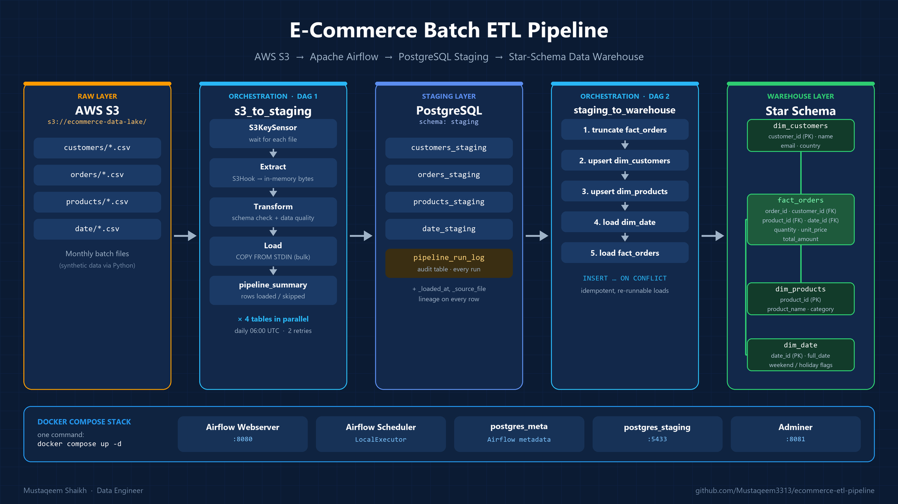

# 🛒 E-Commerce Batch ETL Pipeline


An end-to-end **batch ETL pipeline** that ingests raw e-commerce data from an **AWS S3** data lake, validates and cleans it, lands it in a **PostgreSQL staging layer**, and models it into a **star-schema data warehouse**. The whole flow is orchestrated by **Apache Airflow** and runs locally with a single `docker compose up`.



---

## ✨ Highlights

| | |
|---|---|
| 🧭 **Two-stage orchestration** | `s3_to_staging` (raw → staging) and `staging_to_warehouse` (staging → star schema) |
| ⚡ **Parallel ingestion** | 4 tables processed in independent Airflow branches |
| 🛡️ **Fail-fast schema validation** | Missing columns stop the load; extra columns are logged and dropped |
| ✅ **Data-quality rules** | Null-key filtering, numeric checks, boolean normalisation, status validation, with row-level warnings |
| 🚀 **Bulk loading** | PostgreSQL `COPY FROM STDIN`, far faster than row-by-row inserts |
| 🔁 **Idempotent loads** | Truncate-and-reload for staging and facts; `INSERT … ON CONFLICT` upserts for dimensions |
| 🧾 **Audit & lineage** | `pipeline_run_log` records every load; `_loaded_at` and `_source_file` on every staging row |
| ⚙️ **Config-driven** | S3 paths and connections set via Airflow Variables/Connections, with no code changes |
| 🐳 **One-command setup** | Airflow + 2× PostgreSQL + Adminer in Docker Compose |

---

## 🏗️ Architecture

```
┌──────────────┐   ┌──────────────────────────┐   ┌───────────────────┐   ┌──────────────────────────┐   ┌──────────────────┐
│  AWS S3      │   │  DAG 1: s3_to_staging    │   │  PostgreSQL       │   │  DAG 2:                  │   │  Warehouse       │
│  (raw layer) │──▶│  S3KeySensor             │──▶│  staging schema   │──▶│  staging_to_warehouse    │──▶│  (star schema)   │
│              │   │  → Extract (S3Hook)      │   │                   │   │  1. truncate fact_orders │   │                  │
│ customers/   │   │  → Transform (validate)  │   │ customers_staging │   │  2. upsert dim_customers │   │  dim_customers   │
│ orders/      │   │  → Load (COPY)           │   │ orders_staging    │   │  3. upsert dim_products  │   │  dim_products    │
│ products/    │   │  → pipeline_summary      │   │ products_staging  │   │  4. load dim_date        │   │  dim_date        │
│ date/        │   │  ×4 tables in parallel   │   │ date_staging      │   │  5. load fact_orders     │   │  fact_orders     │
└──────────────┘   └──────────────────────────┘   │ pipeline_run_log  │   └──────────────────────────┘   └──────────────────┘
                                                  └───────────────────┘
```

### Layers

| Layer | Location | Purpose |
|---|---|---|
| **Raw** | `s3://<bucket>/{customers,orders,products,date}/` | Immutable source CSVs, as delivered |
| **Staging** | PostgreSQL `staging` schema | Validated, lightly cleaned copy of each source file, plus lineage columns |
| **Warehouse** | PostgreSQL `warehouse` schema | Star schema built for analytics and BI |

---

## 🔄 Pipeline Details

### DAG 1: `s3_to_staging`
Runs **daily at 06:00 UTC** with 2 retries (5-minute delay). For each table, in parallel:

1. **`check_s3_<table>`**: an `S3KeySensor` waits (up to 5 minutes) for the source file to land.
2. **`extract_<table>`**: `S3Hook` streams the object into memory (no temp files).
3. **`transform_<table>`**: validates the schema and applies data-quality rules (below).
4. **`load_<table>`**: truncates the staging table and bulk-loads it with `COPY FROM STDIN`, then writes an audit row.
5. **`pipeline_summary`**: logs rows loaded and skipped per table. It runs even if a branch fails (`trigger_rule="all_done"`).

### DAG 2: `staging_to_warehouse`
Triggered manually (or after DAG 1) and run in strict order:

```
truncate_fact_orders → load_dim_customers → load_dim_products → load_dim_date → load_fact_orders
```

- **Dimensions**: `INSERT … ON CONFLICT (key) DO UPDATE` (upsert, Type-1 SCD).
- **dim_date**: `ON CONFLICT DO NOTHING`, because calendar rows never change.
- **fact_orders**: full refresh; `total_amount = quantity × unit_price`, and orders are joined to `date_staging` to resolve `date_id`.

### Data-quality rules (`dags/etl/transform.py`)

| Table | Rule | Action |
|---|---|---|
| All | Header must contain every expected column | ❌ Fail the task |
| All | Unexpected extra columns | ⚠️ Log warning, column dropped |
| All | Whitespace in values | Trimmed |
| customers | Missing `customer_id` | Row skipped |
| customers | `is_active` → boolean (`true/1/yes`) | Normalised |
| products | Missing `product_id` | Row skipped |
| products | Non-numeric `price` / `cost` | Set to NULL, with a warning |
| orders | Missing `order_id` | Row skipped |
| orders | `status` not in `delivered/shipped/processing/cancelled/returned` | Kept, with a warning |

---

## 🧱 Data Model

```
                 ┌────────────────┐
                 │ dim_customers  │
                 │ customer_id PK │
                 └───────┬────────┘
                         │
┌────────────────┐  ┌────┴─────────────┐  ┌────────────────┐
│ dim_date       │  │ fact_orders      │  │ dim_products   │
│ date_id PK     ├──┤ order_id         ├──┤ product_id PK  │
│ full_date      │  │ customer_id  FK  │  │ product_name   │
│ is_weekend     │  │ product_id   FK  │  │ category       │
│ is_holiday     │  │ date_id      FK  │  └────────────────┘
└────────────────┘  │ quantity         │
                    │ unit_price       │
                    │ total_amount     │
                    └──────────────────┘
```

DDL: [`sql/init_staging.sql`](sql/init_staging.sql) · [`sql/init_warehouse.sql`](sql/init_warehouse.sql)

---

## 📁 Project Structure

```
ecommerce-etl-pipeline/
├── docker-compose.yml              # Airflow (webserver + scheduler) + 2× Postgres + Adminer
├── .env.example                    # Copy → .env and fill in credentials
├── requirements.txt
├── generate_data.py                # Synthetic customers / products / orders (Faker)
├── generate_dates.py               # Date-dimension generator
│
├── dags/
│   ├── s3_to_staging_dag.py        # DAG 1: S3 → staging
│   ├── staging_to_warehouse_dag.py # DAG 2: staging → star schema
│   └── etl/
│       ├── extract.py              # S3Hook → BytesIO
│       ├── transform.py            # Schema validation + data-quality rules
│       └── load.py                 # COPY FROM STDIN + audit logging
│
├── sql/
│   ├── init_staging.sql            # Staging tables + pipeline_run_log
│   └── init_warehouse.sql          # Dimension + fact tables
│
├── scripts/
│   └── init_db.sh                  # Postgres init helper
│
├── docs/
│   └── architecture.png
│
└── data/                           # Sample CSVs for local testing
    ├── customers/customers_2024_10.csv
    ├── orders/orders_2024_10.csv
    ├── products/products_2024_10.csv
    └── date/date_2024_10_v2.csv
```

---

## 🚀 Quick Start

### Prerequisites
- Docker Desktop 4.x+ (Compose v2)
- An AWS account with an S3 bucket and an IAM user with `s3:GetObject` / `s3:ListBucket`
- (Optional) AWS CLI for uploading sample data

### 1. Clone and configure
```bash
git clone https://github.com/Mustaqeem3313/ecommerce-etl-pipeline.git
cd ecommerce-etl-pipeline
cp .env.example .env
```
Fill in `.env`. Generate the keys with:
```bash
python -c "from cryptography.fernet import Fernet; print(Fernet.generate_key().decode())"   # FERNET_KEY
python -c "import secrets; print(secrets.token_hex(32))"                                   # WEBSERVER_SECRET_KEY
```

### 2. Upload sample data to S3
```bash
aws s3 cp data/customers/customers_2024_10.csv s3://$S3_BUCKET/customers/
aws s3 cp data/orders/orders_2024_10.csv       s3://$S3_BUCKET/orders/
aws s3 cp data/products/products_2024_10.csv   s3://$S3_BUCKET/products/
aws s3 cp data/date/date_2024_10_v2.csv        s3://$S3_BUCKET/date/
```

### 3. Start the stack
```bash
mkdir -p logs plugins config
docker compose up -d
docker compose logs -f airflow-webserver   # wait for "Listening at: http://0.0.0.0:8080"
```

| Service | URL | Credentials |
|---|---|---|
| Airflow UI | http://localhost:8080 | `admin` / `admin` |
| Adminer (DB UI) | http://localhost:8081 | server `postgres_staging`, values from `.env` |
| Staging Postgres | `localhost:5433` | values from `.env` |

### 4. Run the pipeline
1. In Airflow, switch **`s3_to_staging`** on and trigger it. The 4 branches run in parallel.
2. When it succeeds, trigger **`staging_to_warehouse`**.

### 5. Verify
```sql
-- Staging row counts + audit trail
SELECT table_name, rows_loaded, status, run_date
FROM staging.pipeline_run_log
ORDER BY run_date DESC;

-- Revenue by category and month, straight from the star schema
SELECT d.year, d.month_name, p.category, SUM(f.total_amount) AS revenue
FROM warehouse.fact_orders f
JOIN warehouse.dim_products p ON p.product_id = f.product_id
JOIN warehouse.dim_date     d ON d.date_id    = f.date_id
GROUP BY d.year, d.month, d.month_name, p.category
ORDER BY d.year, d.month, revenue DESC;
```

---

## ⚙️ Configuration

Override any of these in **Airflow → Admin → Variables** without touching code:

| Variable | Default |
|---|---|
| `s3_bucket` | `your-ecommerce-data-lake` |
| `s3_key_customers` | `customers/customers_2024_10.csv` |
| `s3_key_orders` | `orders/orders_2024_10.csv` |
| `s3_key_products` | `products/products_2024_10.csv` |
| `s3_key_date` | `date/date_2024_10_v2.csv` |
| `aws_conn_id` | `aws_default` |
| `pg_conn_id` | `postgres_staging` |

Connections `aws_default` and `postgres_staging` are injected from `.env` via `AIRFLOW_CONN_*` environment variables.

---

## 🧠 Design Decisions

- **ETL with a thin transform.** Staging only enforces schema and basic quality. Business logic lives in the warehouse layer, so raw-to-staging stays simple and replayable.
- **`COPY` over `INSERT`.** Bulk loading avoids per-row round trips and scales to millions of rows.
- **Idempotency first.** Every task can be re-run safely: staging is truncate-and-reload, dimensions are upserted, and facts are fully refreshed.
- **Separate metadata and data databases.** Airflow's metadata DB is isolated from the analytics DB, as it would be in production.
- **Observability built in.** The audit table and the per-run summary make data issues visible without digging through logs.

---

## 🐛 Troubleshooting

| Problem | Fix |
|---|---|
| Webserver won't start | `docker compose logs airflow-webserver`; usually a missing `AIRFLOW__CORE__FERNET_KEY` |
| S3 sensor times out | Check the bucket and key in Airflow Variables, and the IAM permissions on `aws_default` |
| `warehouse.*` tables missing | Init scripts only run on an empty volume, so run `docker compose down -v && docker compose up -d` |
| Reset everything | `docker compose down -v` (⚠️ wipes both databases) |

---

## 🛣️ Roadmap

- [ ] Trigger `staging_to_warehouse` automatically from DAG 1 (`TriggerDagRunOperator` / Datasets)
- [ ] Incremental loads using watermarks instead of a full refresh
- [ ] dbt models + tests for the warehouse layer
- [ ] Great Expectations / Soda data-quality checks
- [ ] Unit tests for `transform.py` (pytest)
- [ ] CI with GitHub Actions (lint + DAG import test)
- [ ] Power BI / Metabase dashboard on the star schema

---

## 👤 Author

**Mustaqeem Shaikh**, Data Engineer
[LinkedIn](https://www.linkedin.com/in/mustaqeemshaikh3313/) · [GitHub](https://github.com/Mustaqeem3313)

## 📝 License

MIT
